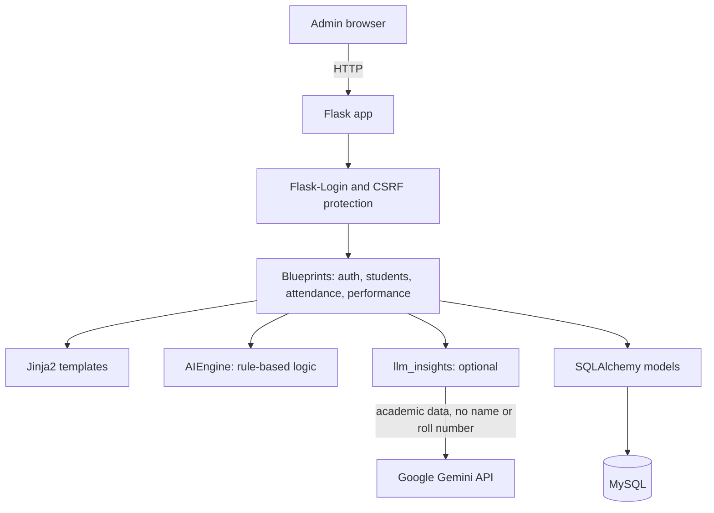
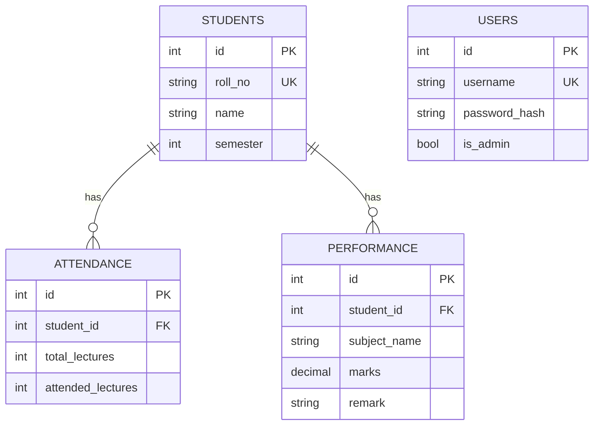
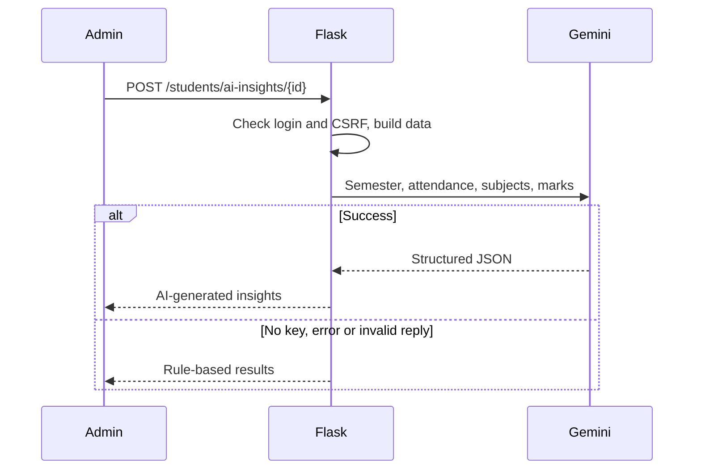

# AI-Assisted Smart Attendance & Performance Tracker

A Flask web app that helps a teacher or admin manage students, attendance and marks, with optional AI-generated academic advice.

## Features

- **Students:** add, view, edit, delete, search, paginate
- **Attendance:** one running record per student (total and attended lectures), shortage warnings below 75%
- **Performance:** subject-wise marks out of 100, automatic remarks, averages
- **Reports:** dashboard counts, per-student report, CSV export
- **AI insights (optional):** summary, strengths, concerns and action plan from Google Gemini
- **UI:** light and dark theme

## System Architecture



| Layer | Location | Responsibility |
|---|---|---|
| Entry point | `run.py` | Starts the development server |
| App factory | `app/__init__.py` | Config, extensions, blueprints, error pages |
| Config | `app/config.py` | Reads `.env` |
| Routes | `app/routes/` | HTTP handling, forms and validation |
| Rules | `app/services/ai_engine.py` | Remarks, warnings, calculations, status |
| LLM | `app/services/llm_insights.py` | Gemini request and response validation |
| Data | `app/models.py` | ORM models |
| Views | `app/templates/`, `app/static/` | HTML, CSS, JavaScript |

## Data Model



The app keeps one attendance record per student; the database does not enforce this. Deleting a student also deletes their attendance and marks.

## How It Works

1. **Login:** the password is checked against its stored hash. All student data pages require login.
2. **Request:** a blueprint validates the form (including its CSRF token), then reads or writes through SQLAlchemy.
3. **Analysis:** `AIEngine` calculates warnings, remarks and status.
4. **Rendering:** Jinja2 returns the HTML page. CSV export is generated in memory.

## Intelligence Layer

### Rule-based (always on, no API key)

Despite the class name `AIEngine`, this part uses fixed rules, not machine learning.

| Rule | Logic |
|---|---|
| Remark | 75 or more: Good; 50 to below 75: Average; below 50: Needs Improvement |
| Attendance warning | Below 75%; high severity if more than 10 points short |
| Lectures needed | `ceil((75*total - 100*attended) / 25)` consecutive lectures |
| Student status | Combines attendance and average marks; Unknown when data is missing |
| Input checks | Roll number, name and semester |

These stay rule-based because results must be exact and repeatable.

### Generative AI (optional)

Used where free-form advice adds value. Open a student's details or report page and click **Generate AI Insights**.



- **On demand:** the API is called only when the button is clicked.
- **Structured:** the reply must match the `StudentInsight` schema.
- **Privacy:** student name and roll number are not sent. Subject names are sent as typed, so keep personal details out of them. Check Google's data-use terms, especially for the free tier, before using real student data.
- **Not stored:** insights are not saved to the database.
- **Review:** AI output can be wrong. Treat it as a suggestion.

## Tech Stack

Python, Flask, Flask-SQLAlchemy, Flask-Login, Flask-WTF, MySQL (PyMySQL), Jinja2, HTML/CSS/JavaScript, Google Gen AI SDK.

## Project Structure

```
├── app/
│   ├── __init__.py
│   ├── config.py
│   ├── models.py
│   ├── routes/        # auth, students, attendance, performance
│   ├── services/      # ai_engine.py, llm_insights.py
│   ├── templates/
│   └── static/
├── db_setup.sql
├── sample_data.py
├── fix_admin_password.py
├── requirements.txt
├── .env.example
└── run.py
```

## Setup

Requires Python 3 and MySQL 8.0+.

```bash
git clone https://github.com/Mohit17Mak/AI_Attendance_Tracker_System.git
cd AI_Attendance_Tracker_System

python -m venv venv
source venv/bin/activate        # Windows: venv\Scripts\activate
pip install -r requirements.txt

mysql -u root -p < db_setup.sql
cp .env.example .env            # Windows: copy .env.example .env
```

Edit `.env`:

| Variable | Purpose |
|---|---|
| `SECRET_KEY` | Set a long random value |
| `DB_HOST`, `DB_PORT`, `DB_USER`, `DB_PASSWORD`, `DB_NAME` | MySQL connection |
| `DEBUG` | Keep `False` outside local debugging |
| `GEMINI_API_KEY` | Optional; get one from Google AI Studio |
| `GEMINI_MODEL` | Defaults to `gemini-3.8-flash` |

Optional sample data. **Warning:** this deletes all existing students, attendance and marks first.

```bash
python sample_data.py 30
```

Run, then open http://localhost:5000:

```bash
python run.py
```

Default login: `admin` / `admin123`. If it fails on an existing database, run `python fix_admin_password.py`, which resets it to `admin123`. Change this password before real use; the app has no change-password page yet.

## Routes

All routes except `/auth/login` require login.

| Area | Routes |
|---|---|
| Auth | `/auth/login`, `/auth/logout` |
| Dashboard | `/dashboard` |
| Students | `/students`, `/students/add`, `/students/export`, `/students/{view,edit,delete,report,ai-insights}/<id>` |
| Attendance | `/attendance/{view,add,mark}`, `/attendance/{detail,edit,delete,reset}/<id>` |
| Performance | `/performance/{view,add,enter}`, `/performance/{detail,edit,delete}/<id>`, `/performance/student/<id>`, `/performance/delete-all/<id>` |

## Security

- Hashed passwords and login-protected data
- CSRF protection on form submissions
- Queries through the SQLAlchemy ORM
- Login redirects limited to local paths
- Debug off and localhost-only by default

## Manual Test Checklist

- [ ] Login and logout work; logged-out users are redirected
- [ ] Add, edit and delete a student; duplicate roll numbers are rejected
- [ ] Zero attended lectures and zero marks are accepted
- [ ] 2 of 4 lectures shows a warning and 4 lectures needed
- [ ] Marks of 85, 60 and 40 give the three remarks
- [ ] Search, pagination, CSV export and theme toggle work
- [ ] AI button shows rule-based results without a key
- [ ] AI button shows AI insights with a valid key

## Limitations and Future Work

- Single admin role; no change-password page
- No login rate limiting
- No automated test suite in the repository
- The built-in server is for development; deployment needs a production server and HTTPS
- Possible additions: saved insight history, date-wise attendance, class-level analytics
